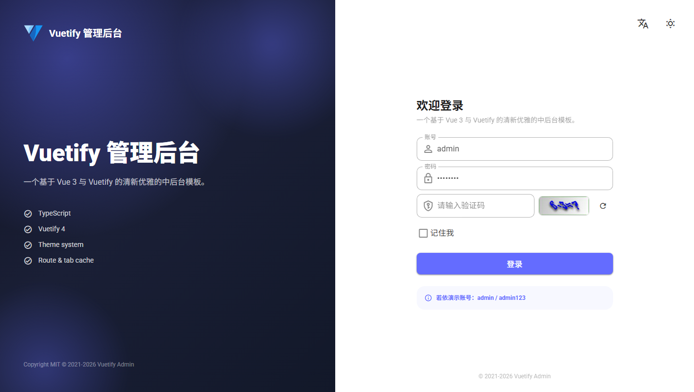
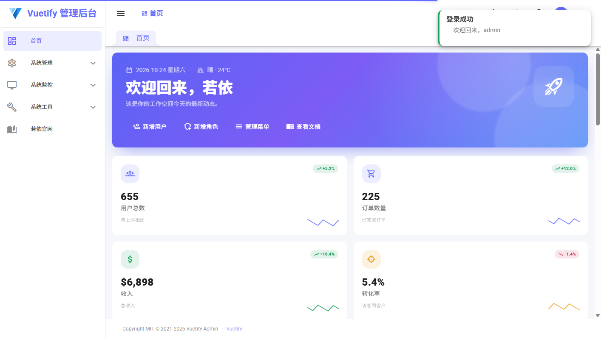
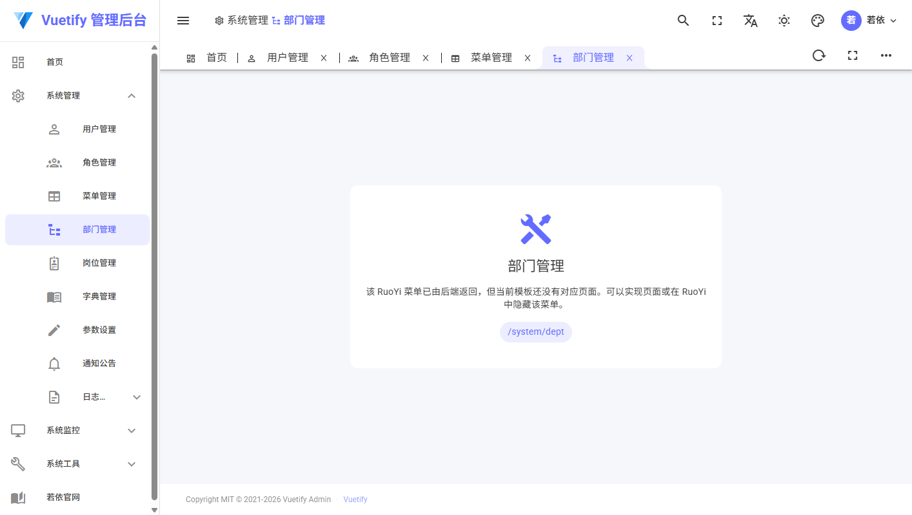
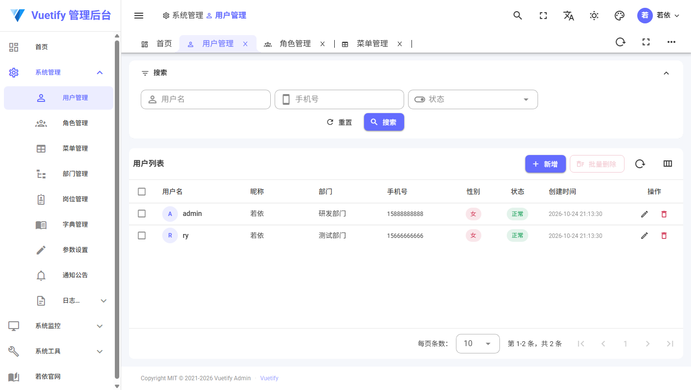
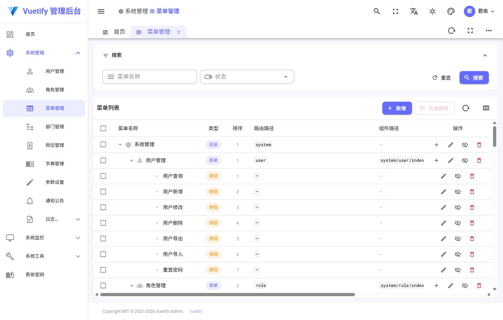
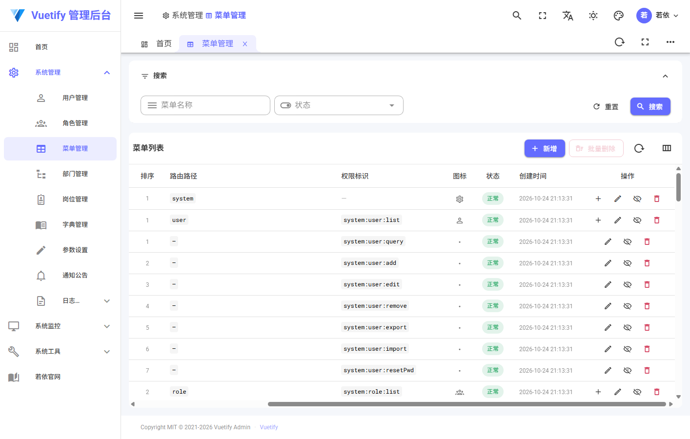

# Backend setup

The frontend uses [RuoYi-Cloud](https://gitee.com/y_project/RuoYi-Cloud) as its backend (springboot3 branch, verified
with v3.6.8). The application code is backend-generic: service, type and router naming do not depend on RuoYi specifics.
The test suite stubs the service modules, so it runs without the backend.

## Frontend

```bash
pnpm install
pnpm dev        # http://localhost:3000
```

Log in with the backend administrator (`admin` / `admin123`). The login form renders the gateway captcha (RuoYi-Cloud
has no SMS/phone-code or password-reset endpoints, so those flows are not part of the UI).

`.env` is committed and contains the local defaults:

| Variable                                | Value                         | Purpose                                           |
| --------------------------------------- | ----------------------------- | ------------------------------------------------- |
| `VITE_SERVICE_BASE_URL`                 | `/api`                        | Dev-server proxy prefix                           |
| `VITE_HTTP_PROXY` / `VITE_PROXY_TARGET` | `Y` / `http://127.0.0.1:8888` | Proxy `/api` to the gateway                       |
| `VITE_SERVICE_SUCCESS_CODE`             | `200`                         | backend success code                              |
| `VITE_SERVICE_LOGOUT_CODES`             | `401`                         | Invalid/expired token                             |
| `VITE_AUTH_ROUTE_MODE`                  | `static`                      | Keep the template routes (see limitations)        |
| `VITE_STATIC_SUPER_ROLE`                | `admin`                       | backend super role bypasses the static role check |
| `VITE_DEFAULT_USER_PASSWORD`            | `admin123`                    | Password used by the create-user form             |

Put machine-specific overrides in `.env.local` (git ignored).

`pnpm build` builds the same configuration. `pnpm test` stubs the service modules, so it runs without the backend.

## Dynamic routes

After login the route store requests `GET /system/menu/getRouters` and `src/router/dynamic.ts` transforms the returned
tree into Vue routes and menus:

- `component: "Layout"` entries become the base-layout wrapper; `ParentView` directories keep their nesting.
- `system/user|role|menu/index` map to the template views (canonical route names `system_user`, `system_role`,
  `system_menu`); every other component path is registered as the **unsupported placeholder** page, so the complete
  backend menu tree (dept, post, dict, config, notice, logs, monitor, tool, ...) is rendered.
- external links (entries with `meta.link`, e.g. Sentinel/Nacos/Swagger/若依官网) become `/external/...` routes
  with `meta.href`; clicking them opens the target in a new tab.
- `hidden`, `noCache` and the tree order map to `hideInMenu`, `keepAlive` and menu order; icons are translated
  from Element icon names to the bundled MDI font.

Adding a real view for another backend page only requires an entry in `COMPONENT_VIEWS` in `src/router/dynamic.ts` plus
the view component. `VITE_AUTH_ROUTE_MODE=static` still uses the template's bundled routes.

## Backend prerequisites

RuoYi-Cloud needs Nacos, MySQL and Redis. In the verified environment they were already provided by the local Docker
compose stack:

- Nacos 3.x: `8848` (client) and `8080` (console)
- MySQL 8: `localhost:3306`, `root` / `123456`
- Redis 6: `localhost:6379`, password `123456`

The Nacos console occupies port `8080`, so the gateway is started on `8888` (see below).

## Backend setup used for verification

The backend repository is cloned next to the frontend:

```bash
git clone -b springboot3 https://gitee.com/y_project/RuoYi-Cloud.git
```

1. **Business database** — create a separate schema (the template's environment may already contain other backend
   schemas) and import the bundled SQL:

   ```bash
   docker exec mysql mysql -uroot -p123456 -e \
     "CREATE DATABASE IF NOT EXISTS ry_cloud_std DEFAULT CHARACTER SET utf8mb4 COLLATE utf8mb4_general_ci;"
   docker cp sql/ry_20260417.sql mysql:/tmp/ry.sql
   docker exec mysql sh -c "mysql -uroot -p123456 ry_cloud_std < /tmp/ry.sql"
   ```

2. **Nacos configuration** — `sql/ry_config_20260818.sql` seeds a Nacos database named `ry-config`. Import it,
   then copy the config rows into the Nacos database the running server uses (`nacos`) with the local datasource and
   Redis settings. Adjust the data source URL, password and Redis password to your environment; the SQL below shows
   the edits made for the verified setup:

   ```bash
   docker cp sql/ry_config_20260818.sql mysql:/tmp/ry-config.sql
   docker exec mysql sh -c "mysql -uroot -p123456 < /tmp/ry-config.sql"
   ```

   ```sql
   INSERT INTO nacos.config_info
     (data_id, group_id, content, md5, gmt_create, gmt_modified, src_user, src_ip, app_name,
      tenant_id, c_desc, c_use, effect, type, c_schema, encrypted_data_key)
   SELECT c.data_id, c.group_id, t.content, MD5(t.content), NOW(), NOW(), 'ruoyi', '127.0.0.1', '',
          n.tenant_id, NULL, NULL, NULL, 'yaml', NULL, ''
   FROM `ry-config`.config_info c
   JOIN (
     SELECT id,
       REPLACE(REPLACE(REPLACE(REPLACE(content,
         '3306/ry-cloud?', '3306/ry_cloud_std?'),
         'password: password', 'password: 123456'),
         'useSSL=true', 'useSSL=false&allowPublicKeyRetrieval=true'),
         'http://localhost:8080/', 'http://localhost:8888/') AS content
     FROM `ry-config`.config_info
   ) t ON t.id = c.id
   CROSS JOIN (SELECT '' AS tenant_id UNION ALL SELECT 'public') n
   WHERE c.data_id IN (
     'application-dev.yml','ruoyi-gateway-dev.yml','ruoyi-auth-dev.yml','ruoyi-system-dev.yml',
     'ruoyi-monitor-dev.yml','ruoyi-gen-dev.yml','ruoyi-job-dev.yml','ruoyi-file-dev.yml',
     'sentinel-ruoyi-gateway'
   );
   ```

   The Redis password also has to be set in `ruoyi-auth-dev.yml`, `ruoyi-gateway-dev.yml` and
   `ruoyi-system-dev.yml` (`spring.data.redis.password: 123456`).

   Nacos caches configuration in memory: restart the container after writing to its database.

3. **Build and run the services** (JDK 21 and Maven 3.9 were used):

   ```bash
   mvn -T 1C -DskipTests -Dmaven.test.skip=true \
     -pl ruoyi-gateway,ruoyi-auth,ruoyi-modules/ruoyi-system -am package

   java -jar ruoyi-modules/ruoyi-system/target/ruoyi-modules-system.jar   # :9201
   java -jar ruoyi-auth/target/ruoyi-auth.jar                             # :9200
   java -jar ruoyi-gateway/target/ruoyi-gateway.jar --server.port=8888    # :8888
   ```

   ```bash
   # smoke check
   curl -H "Accept: text/plain" http://127.0.0.1:8888/code
   ```

## Screenshots

The login form uses the backend gateway captcha:



After a successful login the dashboard shows the signed-in backend user:



The sidebar, breadcrumb and tabs are generated from the backend menu tree; pages without a template view render the
unsupported placeholder:



The system user page reads the backend `/system/user/list` endpoint (roles fall back to "—" because the list endpoint
does not include them):



The menu management page renders the flat backend menu list as a depth-first tree (directories, pages and button permissions):



The action column uses Vuetify's built-in `fixed: 'end'` column option, so it stays pinned to the right edge when the table scrolls horizontally:



## API mapping

| UI feature               | backend endpoint                                                                                           |
| ------------------------ | ---------------------------------------------------------------------------------------------------------- |
| Captcha                  | `GET /code` (`Accept: text/plain`)                                                                         |
| Route tree / menu        | `GET /system/menu/getRouters` (drives the dynamic routes and sidebar)                                      |
| Login / logout / refresh | `POST /auth/login`, `DELETE /auth/logout`, `POST /auth/refresh`                                            |
| User info                | `GET /system/user/getInfo` (roles + permissions)                                                           |
| User CRUD                | `/system/user/list`, `POST/PUT /system/user`, `DELETE /system/user/{ids}`, `PUT /system/user/changeStatus` |
| Role CRUD                | `/system/role/list`, `/system/role/optionselect`, `POST/PUT /system/role`, `DELETE /system/role/{ids}`     |
| Menu CRUD                | `/system/menu/list` (flat), `POST/PUT /system/menu`, `DELETE /system/menu/{menuId}`                        |
| Home dashboard           | Composed client-side from user/role/menu counts                                                            |

The service layer uses these backend fields directly: flat `{ total, rows }` tables, status
`0`/`1`, sex `0`/`1`/`2`, permission codes such as `system:user:remove`, and menu types `M`/`C`/`F`. Page and app tests
stub the service modules, so no backend is required to run the suite.

## Known limitations

- **Pages without a view**: the menu tree comes from the backend, but only `system/user`, `system/role` and `system/menu`
  have template views. The other pages (dept/post/dict/config/notice/logs/monitor/tool) render the placeholder page with
  the backend title; they are real dynamic routes, just without a custom UI.
- **Server-side filters**: the backend only supports `userName` / `phonenumber` / `status` for users and
  `roleName` / `roleKey` / `status` for roles. The extra template filters (nickname, email, gender, sorting) are
  no-ops in backend mode.
- **Role user count** is not returned by the backend role list, so the role table shows `0`.
- Creating a user uses `VITE_DEFAULT_USER_PASSWORD` and `deptId = 100`; creating a role sends
  `roleSort = 99` and no menu permissions (the template has no permission-tree UI).
- Menu creation sends an empty `component`; backend may require one for page-type menus.
- The home dashboard values are derived from real user/role/menu counts; orders/revenue/traffic values are synthetic.
